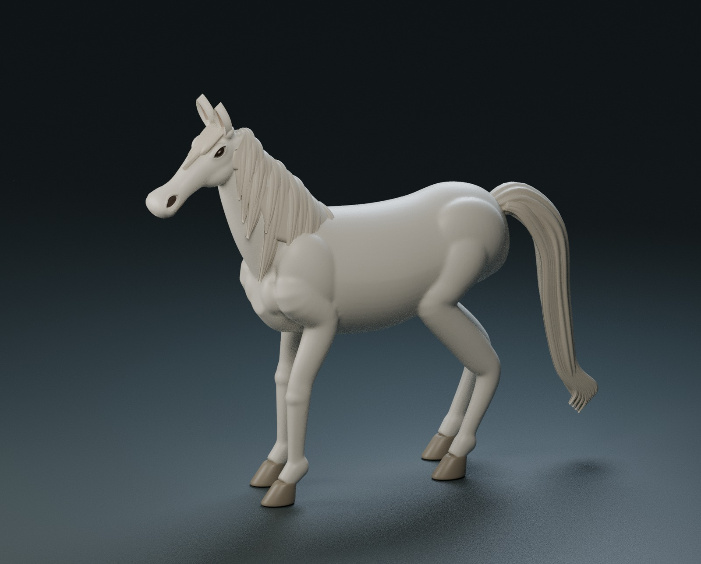
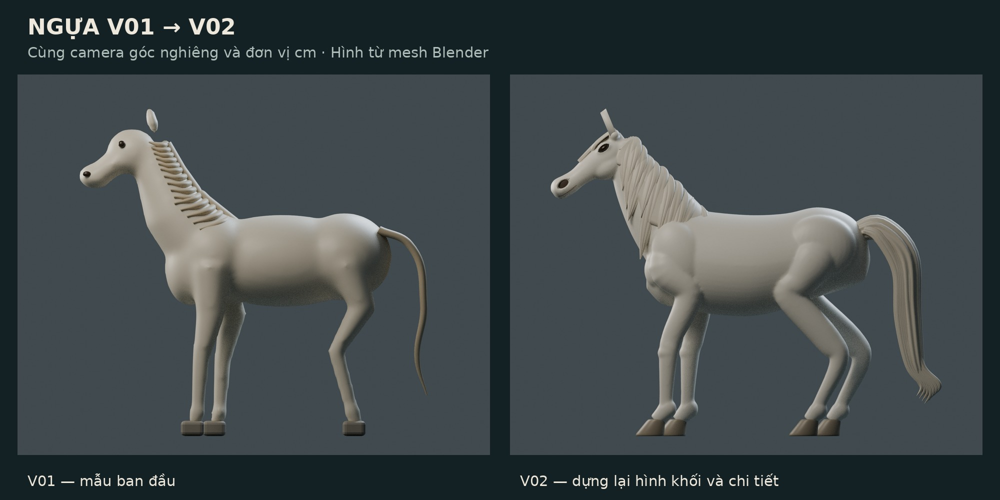

# Nương dòng bình yên

Nghiên cứu tiểu cảnh để nặn đất sét cho bài tập thiết kế. Tác phẩm hoàn thiện dự kiến nằm trong **20 × 20 cm**, chiều cao thiết kế ban đầu **27,9 cm**.

**Hiện tại: giai đoạn 02 — dựng lại và polish ngựa.** Ngựa là nhân vật chính; núi, cây và dòng nước sẽ tạo không gian nâng đỡ. Chưa ghép toàn cảnh. Bản v01 được giữ lại để đối chiếu.

## Xem ngay trên GitHub

### So sánh v01 và v02

Đã dựng lại khối thân, đầu, khớp chân và móng; tạo hốc mắt/lỗ mũi lõm, tai có lòng, bờm và đuôi chồng lớp có rãnh hình học. Ba tư thế giữ cùng tỉ lệ thân/chân; bờm của hai ngựa cúi đầu có hướng rủ riêng theo trọng lực.

[Xem toàn bộ ảnh nhiều góc, cận đầu/bờm/chân/đuôi và hai tư thế cúi đầu](design/stage_02/README.md).

## Tải file

- [Bộ ngựa v02 ZIP — file Blender, thư viện riêng, PDF và số đo](design/Nuong_dong_binh_yen_horses_v02.zip).
- [File Blender chính — ba ngựa v02](design/stage_02/Nuong_dong_binh_yen_horses_v02.blend).
- [Phiếu thiết kế ngựa v02 PDF](design/stage_02/Horse_design_review_v02.pdf).
- [Bảng kích thước ngựa CSV](design/stage_02/measurements/horse_dimensions.csv).
- [Bộ thành phần giai đoạn 01 — núi, cây, nước, mây…](design/stage_01/README.md).
- [ZIP giai đoạn 01](design/Nuong_dong_binh_yen_stage01.zip) và [mặt bằng v01 in 1:1](design/stage_01/Phieu_thiet_ke_giai_doan_01.pdf).

Đối với `.blend` và ZIP, mở liên kết rồi chọn **Download raw file** để tải. Với PDF, GitHub có thể hiển thị ngay trong trang; nếu chưa hiển thị, chọn tải file. Mặt bằng v01 chưa cập nhật hộp bao ngựa v02. Khi in mặt bằng, chọn **Actual size / 100%** và kiểm tra thước 50 mm trên trang.

## Ý tưởng và trạng thái

Thông điệp: **thiên nhiên và sự bình yên**. Ba chú ngựa nghỉ ngơi bên cùng một dòng nước; núi và cây tạo sự che chở. Bốn góc trong ảnh AI tham khảo là các góc nhìn của cùng một tác phẩm, không phải bốn tác phẩm.

Ảnh AI không cung cấp số đo vật thể đáng tin cậy. Bộ số đo ở đây là phương án thiết kế mới, đã kiểm trực tiếp từ mesh Blender. Các ngựa v02 thay thế ba ngựa mẫu của giai đoạn 01; số đo mới nằm trong `design/stage_02/measurements/`. Hộp bao ở vị trí lắp dự kiến vẫn trong giới hạn 20 × 20 × 27,9 cm. Chưa kiểm cảnh lắp, tiếp xúc móng–đá/miệng–nước, độ bền hoặc độ co ngót của đất.

Đây là nghiên cứu tượng ngựa cách điệu và tiểu cảnh để nặn tay, chưa phải bộ file in 3D sẵn dùng. [Đọc hướng dẫn v02, phép kiểm và cách tái tạo](design/stage_02/README.md).
