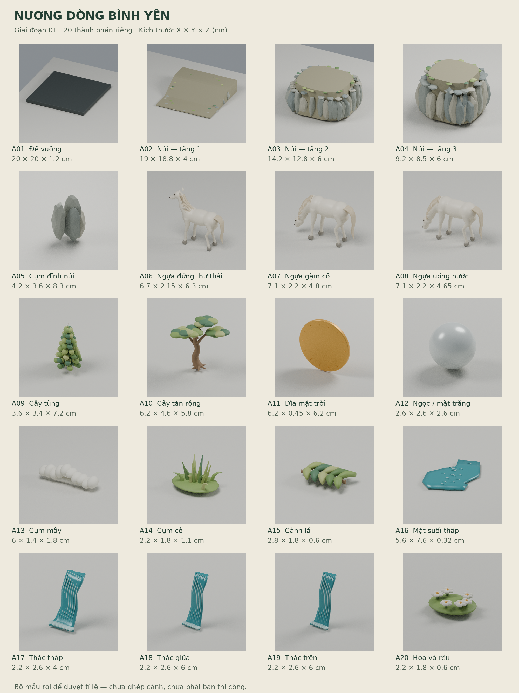
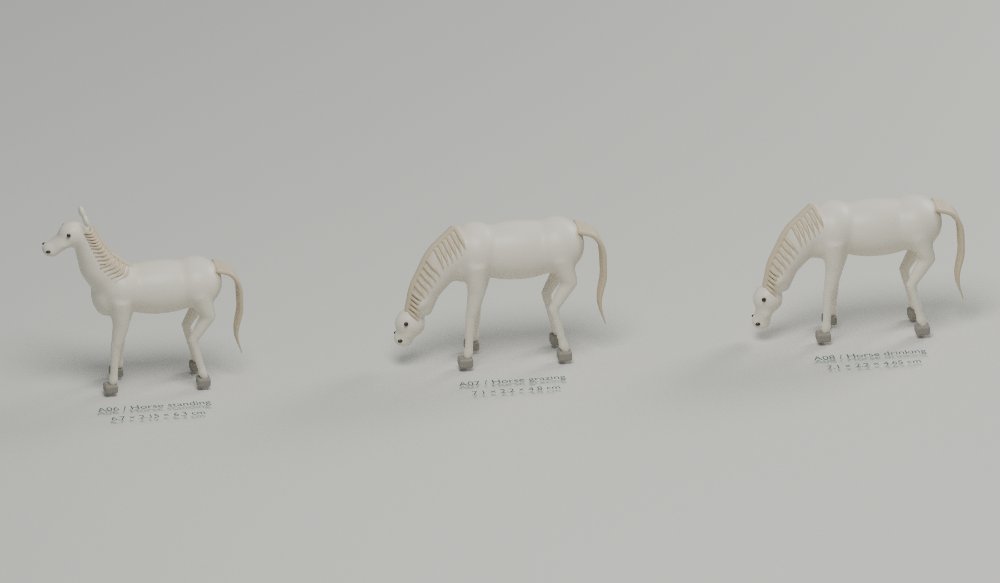
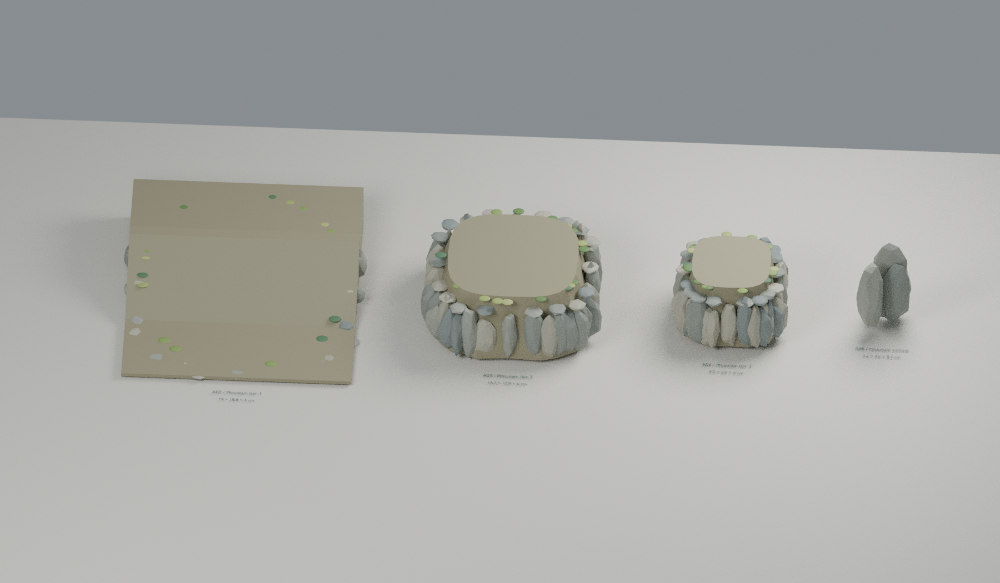

# Nương dòng bình yên

Nghiên cứu tiểu cảnh để nặn đất sét cho bài tập thiết kế. Tác phẩm hoàn thiện dự kiến nằm trong **20 × 20 cm**, chiều cao thiết kế ban đầu **27,9 cm**.

**Hiện tại: giai đoạn 01 — các thành phần rời, chưa ghép toàn cảnh.** Bàn trưng bày trong file Blender lớn hơn kích thước tác phẩm để mỗi bộ phận có một chỗ riêng. Kích thước trong bảng là cm.

## Xem ngay trên GitHub

### Ba tư thế ngựa

### Các tầng núi

## Tải file

- [Toàn bộ bộ mẫu ZIP — khoảng 40 MB](design/Nuong_dong_binh_yen_stage01.zip).
- [File Blender chính — 20 thành phần riêng](design/stage_01/Nuong_dong_binh_yen_components_v01.blend).
- [Phiếu thiết kế PDF — 5 trang, có mặt bằng in 1:1](design/stage_01/Phieu_thiet_ke_giai_doan_01.pdf).
- [Bảng kích thước CSV](design/stage_01/measurements/components.csv).
- [Ảnh và thư viện chi tiết](design/stage_01).

Đối với `.blend` và ZIP, mở liên kết rồi chọn **Download raw file** để tải. Với PDF, GitHub có thể hiển thị ngay trong trang; nếu chưa hiển thị, chọn tải file. Khi in mặt bằng, chọn **Actual size / 100%** và kiểm tra thước 50 mm trên trang.

## Ý tưởng và trạng thái

Thông điệp: **thiên nhiên và sự bình yên**. Ba chú ngựa nghỉ ngơi bên cùng một dòng nước; núi và cây tạo sự che chở. Bốn góc trong ảnh AI tham khảo là các góc nhìn của cùng một tác phẩm, không phải bốn tác phẩm.

Ảnh AI không cung cấp số đo vật thể đáng tin cậy. Bộ số đo ở đây là phương án thiết kế mới, đã kiểm trực tiếp từ mesh Blender. Đã kiểm đủ 20 bộ phận và hộp bao của các vị trí lắp dự kiến trong giới hạn 20 × 20 × 27,9 cm. Chưa kiểm cảnh lắp, tiếp xúc móng–đá/miệng–nước, độ bền hoặc độ co ngót của đất.

Đây là mẫu tỉ lệ v01 để xem xét từng bộ phận, chưa phải bản thi công hoặc bộ file in 3D sẵn dùng. [Đọc hướng dẫn chi tiết và cách tái tạo](design/stage_01/README.md).
