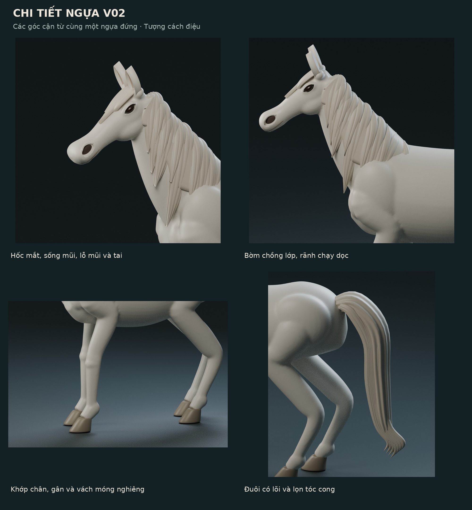

# Giai đoạn 02 — ngựa là nhân vật chính

Tập trung dựng lại ba ngựa của **Nương dòng bình yên**, trước khi ghép cảnh 20 × 20 cm. Bản v01 vẫn ở `../stage_01/` để đối chiếu. Núi, cây, mây và mặt trời chưa thay đổi trong đợt này.

Ngựa là chủ thể của bài chọn một loài vật. Ba cá thể/tư thế kể cùng một nhịp sống: **đứng nghỉ, gặm cỏ, uống nước**. Thiên nhiên sẽ làm không gian nâng đỡ; không để hiệu ứng mặt trời, cây hoặc thác lấn át ngựa khi lắp cảnh.


## So sánh hình khối


## Các thay đổi chính

| Vùng | Thiết kế v02 |
|---|---|
| Thân | Một khối da liên tục; đường lưng, lồng ngực và bụng được dựng bằng các tiết diện riêng; chuyển tiếp vai/hông không còn nắp khối cắt lộ ra ngoài. |
| Tỉ lệ | Thân dài hơn, đầu dài và có mặt phẳng mũi rõ; ba tư thế dùng cùng một hệ tỉ lệ và một hệ số scale đồng nhất. Không ép riêng X/Y/Z vào hộp cũ. |
| Cổ | Phân biệt gốc cổ, đường cong sống cổ và vùng dưới hàm. Dáng đứng hạ đầu nhẹ để bớt cảm giác phô trương. |
| Mắt | Khe mắt hình hạnh nhân khắc vào khối hốc mắt, cầu mắt nhỏ nằm sâu; bỏ viền mí dạng vòng dây đắp rời. |
| Mõm | Sống mũi dài, hàm dưới riêng, lỗ mũi lõm thật; đường môi bám bề mặt thay vì nổi khỏi mặt. |
| Tai | Vỏ tai lõm, đầu thu nhỏ, có độ dày và phần gắn vào hộp sọ. |
| Chân | Đường chuyển vai–khuỷu–gối/cổ chân–cẳng–khớp dưới; có khối gân và góc đốt chân xuống móng. |
| Móng | Vách móng nghiêng, mũi rộng hơn phần trên; bỏ khối hộp và vòng trắng giống vòng trang sức. |
| Bờm | Nền tóc liền, các lọn lớn/nhỏ chồng nhau theo hướng vuốt về vai; rãnh dọc là hình học thật. Có bờm trán riêng. |
| Đuôi | Lõi có độ dày, đường cong chữ S, các lọn dài có rãnh và đầu thuôn/cuộn nhẹ. |

Phong cách là **tượng ngựa cách điệu có cơ sở giải phẫu**, phù hợp tiểu cảnh đất sét; không phải bản quét ngựa thật hoặc mô hình giải phẫu thú y. Ánh sáng rọi xiên được dùng để làm lộ lỗi hình khối trong quá trình kiểm.

## Xem các góc và chi tiết



- [Góc nghiêng trái](renders/02_profile_left.png).
- [Chính diện](renders/03_front.png).
- [Góc 3/4 phía đối diện, kiểm mặt không có bờm](renders/04_opposite_three_quarter.png).
- [Cận đầu](renders/05_head_detail.png), [bờm](renders/06_mane_detail.png), [chân/móng](renders/07_leg_and_hoof_detail.png), [đuôi](renders/08_tail_detail.png).
- [Ngựa gặm cỏ](renders/09_grazing.png), [ngựa uống nước](renders/10_drinking.png).

## File và đơn vị

- `Nuong_dong_binh_yen_horses_v02.blend`: scene chính, ba ngựa tách nhau ở các vị trí X = 0 / 11 / 22 cm, có ánh sáng và camera xem ngựa đứng.
- `assets/H01_standing.blend`, `H02_grazing.blend`, `H03_drinking.blend`: thư viện collection riêng, gốc ở tâm đáy. Append vào scene chính hoặc scene có Unit Scale = 0.01.
- `measurements/horse_dimensions.csv`: số đo hộp bao từ mesh lưu lại, bao gồm bờm và đuôi.
- `measurements/validation.json`: đọc lại file, kiểm hình học và mặt phẳng tiếp xúc móng.
- `measurements/leg_sections.csv`: các lát cắt cẳng chân thực tế; có thể xem để biết chi tiết mảnh đến mức nào.
- `Horse_design_review_v02.pdf`: phiếu xem và trao đổi với người nặn.

**1 đơn vị Blender = 1 cm**. Các vị trí trên bàn thư viện không phải vị trí trong cảnh lắp. Ba ngựa cùng tỉ lệ thân, khác tư thế; số đo hộp bao vì vậy khác nhau. Con số bốn chữ số thập phân trong JSON mô tả mesh số, không phải độ chính xác có thể đạt khi nặn.

## Đã kiểm và còn phải kiểm

Đã kiểm: file lưu mở lại được; số đo khớp mesh; bốn đáy móng của mỗi ngựa cùng nằm trên Z = 0 ở scene nghiên cứu. Khối da chính của mỗi con được kiểm riêng về biên hở và phần rời. Bờm, mắt, tai và móng vẫn là các mesh riêng để chỉnh sửa; toàn bộ asset chưa được hợp nhất thành một khối sản xuất.

Các lát cắt cẳng chân chỉ lấy ở một số cao độ từ 0,65 đến 1,15 cm, đo theo X/Y; vùng đầu cúi thấp được loại khỏi phép lấy lát cắt chân. Đây không phải chứng nhận đường kính nhỏ nhất hay độ bền. Móng đồng phẳng trên bàn không tự chứng minh đã đứng đúng trên địa hình.

Chưa kiểm ở giai đoạn này: tiếp xúc móng–đá khi ghép, miệng–nước sau khi đặt cảnh, va chạm với cây/núi, độ bền đất, độ co khi khô/nung và kết cấu gia cường. Mẫu này có các chi tiết nhỏ hơn 1 mm ở rãnh tóc/mí/môi; khi nặn có thể diễn tả bằng vết khắc trên mảng lớn thay vì nặn từng sợi rời. Chưa chốt vật liệu nên chưa chốt lõi kim loại, keo hoặc phương án nung.

## Tái tạo

Blender 4.3.2, CPU; không dùng model tải từ bên thứ ba hay dịch vụ tạo mesh. Dựng lại toàn bộ có thể mất vài phút; chuỗi ảnh nhiều góc cần thêm thời gian render.

```sh
blender -b -t 4 --python-exit-code 1 --python design/stage_02/scripts/sculpt_horses.py
blender -b -t 4 --python-exit-code 1 --python design/stage_02/scripts/render_review.py
blender -b -t 1 --python-exit-code 1 --python design/stage_02/scripts/validate_horses.py
python3 design/stage_02/scripts/publish_packet.py
```

Script cuối cần Pillow và ReportLab, đã có trong environment. Nó tạo ảnh xem nhẹ, PDF và ZIP cục bộ; không tự push GitHub.
